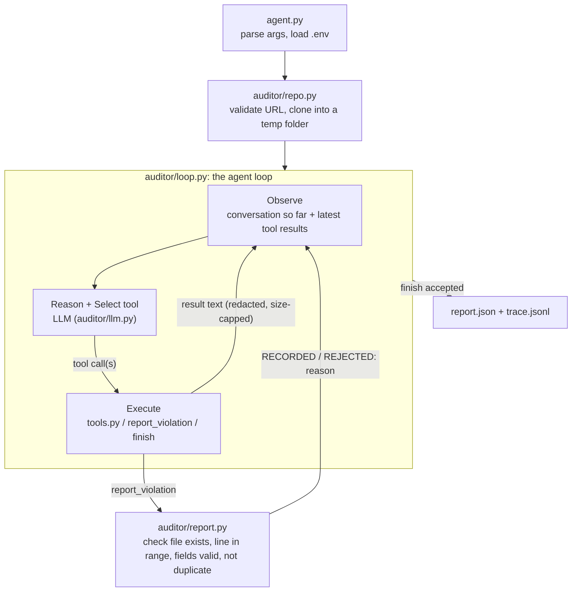

# DevOps Repository Auditing Agent

An AI agent, written from scratch in Python, that inspects any public GitHub repository, finds DevOps
best-practice violations, and writes an evidence-based JSON report with a fix for each one.

```bash
python agent.py --repo https://github.com/owner/name --output report.json
```

The LLM steers the investigation. It looks at the repository, decides which tool to use next, reads the
result, follows up on anything suspicious, and records each finding with a file, a line, and evidence.
No agent framework is used: the reasoning loop, tool dispatch, and control flow are plain Python in
[`auditor/loop.py`](auditor/loop.py).

---

## Contents

1. [Quick start](#1-quick-start)
2. [Configuration](#2-configuration)
3. [How it works (architecture)](#3-how-it-works-architecture)
4. [Inspection tools](#4-inspection-tools)
5. [What it looks for](#5-what-it-looks-for)
6. [Output format](#6-output-format)
7. [Accuracy: avoiding false positives](#7-accuracy-avoiding-false-positives)
8. [Safety and reliability](#8-safety-and-reliability)
9. [Testing](#9-testing)
10. [Measuring precision and recall](#10-measuring-precision-and-recall)
11. [Project layout](#11-project-layout)
12. [Concepts in plain words](#12-concepts-in-plain-words)

---

## 1. Quick start

**Requirements:** Python 3.11 or newer, and `git`.

```bash
git clone https://github.com/<your-username>/devops-audit-agent.git
cd devops-audit-agent

python -m venv .venv
source .venv/bin/activate          # Windows: .venv\Scripts\activate

pip install -r requirements.txt

cp .env.example .env               # Windows: copy .env.example .env
# open .env and paste ONE API key (see "Configuration" below)

python agent.py --repo https://github.com/we45/Vulnerable-Flask-App --output report.json
```

While it runs, the agent prints each step to the terminal (what it is thinking, which tool it called,
and a one-line result). When it finishes you get:

| File | What it is |
|---|---|
| `report.json` | The report, in the required format |
| `report.trace.jsonl` | One line per LLM turn and tool call: the evidence that the agent really investigated |

**Command-line options**

| Option | Default | Meaning |
|---|---|---|
| `--repo` | required | Public GitHub URL (`https://github.com/owner/name`). A local folder path also works, for testing. |
| `--output` | required | Where to write the JSON report |
| `--trace` | `<output>.trace.jsonl` | Where to write the tool-call trace |
| `--max-steps` | 60 | Maximum LLM turns before the agent must stop |
| `--max-minutes` | 20 | Time budget |
| `-q` | off | Quiet: only print errors |

**Exit codes:** `0` means the audit completed and the report was written, even when there are zero
violations. `1` means a fatal error (bad URL, clone failed, missing or invalid API key, LLM unreachable),
and a clear message goes to stderr. If the LLM fails partway through, the violations already confirmed are
saved to `<output>.partial.json` so the work isn't lost, but the exit code is still `1` because the audit is
incomplete. `2` means the command-line arguments were wrong.

## 2. Configuration

Put **one** API key in `.env`. The file is ignored by git, so it never gets committed. You can also
export the variables in your shell instead.

| Provider | Variable | Default model | Notes |
|---|---|---|---|
| Google Gemini | `GEMINI_API_KEY` | `gemini-3.6-flash`, falling back to `gemini-3.5-flash-lite` and then `gemini-3.1-flash-lite` | Free tier. Get a key at https://aistudio.google.com/apikey |
| OpenAI | `OPENAI_API_KEY` | `gpt-4o-mini` | |
| Anthropic | `ANTHROPIC_API_KEY` | `claude-sonnet-5-5` | |
| Groq | `GROQ_API_KEY` | `llama-3.3-70b-versatile` | Free tier |
| Any OpenAI-compatible server | `LLM_PROVIDER=openai` + `OPENAI_BASE_URL` | set `LLM_MODEL` | OpenRouter, Ollama, vLLM, LM Studio... |

Optional variables:

| Variable | Meaning |
|---|---|
| `LLM_MODEL` | Use a different model from the same provider. A comma-separated list works as a fallback chain: when one model's **daily** quota runs out, the agent switches to the next model and carries on. |
| `LLM_PROVIDER` | Force a provider when several keys are set (`gemini`, `openai`, `anthropic`, `groq`) |
| `LLM_REQUEST_DELAY` | Seconds to wait between LLM calls. Try `4` on free tiers with low rate limits. |
| `AUDIT_DISABLE_PYTEST=1` | Never run the target repository's tests, even when Docker is available |

The provider is detected from whichever key is present. The model must support tool (function) calling.
The grade does not depend on the provider. The agent only uses the official SDKs (`openai`, `anthropic`).

## 3. How it works (architecture)



The cycle the assignment asks for, mapped to the code:

| Stage | Where | What happens |
|---|---|---|
| **Observe** | `AuditAgent.run` | The LLM receives the repository summary (default branch, branches, commit count), then the output of every tool it called. |
| **Reason** | the LLM | The system prompt asks it to write one sentence before every tool call: what it just learned and why it picks the next tool. These sentences are saved in the trace. |
| **Select tool** | the LLM | It picks one or more tools, with arguments, using native tool calling. Nothing in the code decides the order. |
| **Execute tool** | `AuditAgent._execute`, `RepoTools.call` | The loop runs the requested tool. Errors come back as text (`ERROR: ...`) so the LLM can adapt. |
| **Interpret results** | the LLM | It reads the output and either follows up with another tool or records a violation with `report_violation`. |
| **Report** | `report.py`, `agent.py` | Validated findings are sorted by severity and written as JSON. |

**Why this counts as a real agent and not a scanner plus a summary**

- The code has no fixed list of checks. The LLM chooses every tool call based on what it has seen.
  For example, it reads a workflow only after discovering it, and searches git history only after
  something suggests a secret might have been removed.
- Findings are recorded during the investigation through a tool (`report_violation`), not written up
  at the end. The loop checks each one against the repository and sends back `REJECTED: line 99 is
  outside app.py (it has 40 lines)` when it doesn't hold, so the LLM has to look again.
- The `finish` tool is refused until the LLM has written a note for each of the nine categories,
  saying what it checked or why the category doesn't apply. The code doesn't say *how* to check them.
  This prevents an early stop without turning the agent into a checklist.
- Before the agent is allowed to finish, it gets one **self-review** turn. Its own findings are shown
  back to it, and it is asked to withdraw (`retract_violation`) anything weak, duplicated, or covered by
  an acceptable alternative. This improves precision.
- The full trace (`*.trace.jsonl`) records every reasoning sentence, tool call, argument, and result, so
  the run can be checked afterwards.

**Budgets:** the agent stops after `--max-steps` LLM turns or `--max-minutes`. Near the limit it is told
to record what it has confirmed and finish. Old tool outputs are shortened when the conversation gets
long, so large repositories don't overflow the model's context.

**LLM layer:** `auditor/llm.py` defines one small interface, `chat(system, messages, tools)`, with two
adapters. One covers OpenAI and every OpenAI-compatible API, including Gemini's thought-signature
passthrough. The other covers Anthropic. Temporary errors (rate limits, 5xx, network) are retried with
exponential backoff. Authentication and bad-request errors stop the run straight away with a clear
message.

## 4. Inspection tools

All tools are in [`tools.py`](tools.py). They only read, and they never run the target's code on the
host. Their output passes through the secret redactor and is capped in size.

| Tool | Required? | What it does |
|---|---|---|
| `list_files(path, max_depth)` | required | Lists files **tracked by git**, which shows what was committed, with sizes |
| `read_file(path, start_line, end_line)` | required | Reads a text file with line numbers, in pages of 400 lines. Refuses paths outside the repo and binary files. |
| `search_code(pattern, path_glob, case_insensitive)` | required | Regex search over every tracked text file. Returns `file:line: text`. |
| `git_log(max_count, path)` | required | Commits with date, author, message and changed files, plus commits per author |
| `search_git_history(pattern)` | extra | Searches added and removed lines in **all** commits (`git log -G`). Finds secrets that were deleted but are still in history. |
| `scan_secrets(include_history)` | extra | Secret scanner. Flags lines in current files that hold real-looking credentials (API keys, tokens, passwords, private keys, passwords in URLs), secret-bearing files such as `.env` or `id_rsa`, and secrets that were committed and later **removed** from the files but are still in history. Values are always `[REDACTED]`. |
| `git_status(include_tags)` | extra | Status, branches, tags |
| `inspect_workflows(file)` | extra | Parses every GitHub Actions workflow and summarizes triggers, permissions, jobs, `needs`, steps, `continue-on-error`, `if:`, actions used, secrets, and **flags** untrusted `github.event` input in `run:` and printed secrets. Also notes other CI systems (GitLab, CircleCI, Jenkins...). |
| `run_ruff(select)` | extra | Ruff linter, which is static analysis and does not execute code. Uses the repo's own Ruff config when it has one. Results are grouped by rule. |
| `run_pytest(test_path)` | extra | Runs the target's tests **only inside a locked-down Docker container**: read-only mount, no extra Linux privileges, memory, CPU and process limits, and a timeout. Without Docker it returns `UNAVAILABLE` and the agent is told not to report test results. |

The agent also has three control tools: `report_violation`, `retract_violation` and `finish`.

## 5. What it looks for

The rule catalogue is in [`auditor/rules.py`](auditor/rules.py). It gives the LLM stable rule ids,
default severities, and the **acceptable alternatives** that mean something is *not* a violation.

| Category | Rule ids | Examples |
|---|---|---|
| Repository hygiene | HYG-001 to 004 | Missing README, unsuitable `.gitignore`, committed `__pycache__`/`.DS_Store`/`dist/`, large binaries |
| Dependency management | DEP-001 to 004 | No manifest, no version constraints and no lockfile, inconsistent manifests, missing lockfile that CI needs |
| Code quality | QUA-001 to 002 | No linter/formatter anywhere, obvious maintainability problems (backed by Ruff output) |
| Testing | TST-001 to 003 | No tests, failing tests (only if actually run), tests never run in CI |
| GitHub Actions / CI | CI-001 to 005 | No CI, wrong triggers or branch names, `continue-on-error`/`\|\| true` gates, skipped validation, actions pinned to `@main` |
| Security | SEC-001 to 007 | Hardcoded credentials, committed `.env`/keys, secrets in git history, `permissions: write-all`, `pull_request_target` + PR checkout, script injection, printed secrets, `verify=False` |
| Configuration | CFG-001 to 003 | `C:\Users\...` paths, committed personal IDE settings, no dev/prod separation |
| Collaboration | COL-001 to 002 | Auto-merge/approve without checks, no review guidance on multi-author projects |
| Build and release | BLD-001 to 003 | Build never validated, deploy not gated on tests, `FROM image:latest` |

The LLM may create a new id in the same style when nothing in the catalogue fits.

## 6. Output format

```json
{
  "repository": "https://github.com/example/demo-project",
  "violations": [
    {
      "rule_id": "SEC-001",
      "category": "security",
      "severity": "critical",
      "file": "config.py",
      "line": 17,
      "description": "Hardcoded API credential",
      "evidence": "Credential assigned directly in source code",
      "recommendation": "Use a secrets manager or environment variable"
    }
  ]
}
```

- Every violation has all eight fields. `severity` is one of `critical`, `high`, `medium`, `low`.
- `file` and `line` are JSON `null` when they don't apply, for example when a repository has no tests at all.
- `category` is one of `repository_hygiene`, `dependency_management`, `code_quality`, `testing`, `ci`,
  `security`, `configuration`, `collaboration`, `build_release`.
- Violations are sorted from most to least severe. A clean repository gives `"violations": []`.
- Secret values never appear. Evidence says *that* a key is hardcoded, not what it is.
- The report is written atomically (to a temp file, then renamed), so a crash never leaves a half-written file.

[`sample_report.json`](sample_report.json) is a real, unedited output of this agent auditing
[we45/Vulnerable-Flask-App](https://github.com/we45/Vulnerable-Flask-App), a project made insecure on
purpose for security training. It was produced with Gemini's free tier (`gemini-3.5-flash-lite`).
[`sample_report.trace.jsonl`](sample_report.trace.jsonl) is the trace from the same run: every reasoning
step and tool call, 21 turns in total. A stronger model generally finds more.

## 7. Accuracy: avoiding false positives

Precision counts as much as recall in grading, so the agent is built to report only what it can prove.

1. **Evidence is checked by code.** A finding is accepted only if the file is really tracked in the
   repo and the line number really exists in that file.
2. **Acceptable alternatives are part of every rule.** For example, `pyproject.toml` counts as well as
   `requirements.txt`, GitLab CI counts as CI, Ruff in pre-commit counts as linting, and
   `.env.example` with placeholders is not a leak.
3. **No claims about things files can't show.** Branch protection, repository settings, and GitHub
   secrets are explicitly excluded. A missing `permissions:` block alone is never reported, because
   the repository default can't be seen.
4. **No invented results.** When a check can't run (no Docker for tests, no Ruff), the tool says
   `UNAVAILABLE` and the agent is told not to report on it.
5. **Duplicates are blocked.** The same rule, file and line, or the same rule and file with no line, is
   recorded only once.
6. **Self-review pass** before finishing, as described in section 3.
7. **Repository content is data.** The prompt tells the model to ignore instructions written inside the
   inspected files (prompt injection).
8. Temperature is 0 where the provider allows it, for repeatable results.

## 8. Safety and reliability

| Concern | How it is handled |
|---|---|
| Never modify the target | It works on a fresh clone in a temp folder, deleted afterwards. Local folders are cloned or copied first. Tools only read. Git hooks are disabled. |
| Untrusted code | Never executed on the host. Ruff is static. Tests run only in an isolated Docker container. Submodules and LFS are not fetched. |
| Path tricks | `read_file` resolves symlinks and refuses anything outside the repository |
| Secrets | `auditor/redact.py` masks known token formats (AWS, GitHub, OpenAI/Anthropic, Google, Slack, Stripe, JWT), private keys, URL passwords and `password = "..."`-style assignments in **every** tool output, trace line and report field. Placeholders and `os.environ[...]` stay visible so the agent can tell them apart from real secrets. |
| Bad input | The URL is validated before anything else, and missing credentials are detected before cloning |
| Network and API errors | Clone timeout (5 min), LLM retries with backoff, a clear error message and exit code 1 |
| Runaway agent | Step and time budgets, with a warning to wrap up near the limit |
| Huge repos and files | Output caps, 400-line pages, 1 MB read limit, trimming of old history |
| Bad tool calls from the LLM | Unknown tools, bad arguments and invalid JSON are returned as `ERROR:` text, and the run continues |

## 9. Testing

```bash
pip install -r requirements-dev.txt
pytest -v
ruff check . && ruff format --check .
```

The tests need **no API key and no network**. The LLM is replaced by a scripted fake (`tests/conftest.py`)
and the provider adapters are tested against a mock HTTP server.

| Test file | Covers |
|---|---|
| `tests/test_tools.py` | Every tool on a throw-away git repo with planted defects, error handling, path traversal, and that the target is never modified |
| `tests/test_redact.py` | Secrets are masked, placeholders are kept |
| `tests/test_report.py` | Evidence validation (missing file, bad line, bad severity), duplicates, retraction, JSON contract |
| `tests/test_agent.py` | Tool results reach the LLM, follow-up calls depend on observations, coverage check, self-review, budgets, trace, and CLI end to end (valid report, empty report, bad URL, LLM failure, exit codes) |
| `tests/test_llm.py` | OpenAI-compatible and Anthropic message formats, Gemini thought signatures, retry vs fatal errors |
| `tests/test_benchmarks.py`, `tests/test_evaluate.py` | The practice repositories and the precision/recall scorer |

GitHub Actions ([`.github/workflows/ci.yml`](.github/workflows/ci.yml)) runs lint, formatting, the
tests on Python 3.11, 3.12 and 3.13, and a check that `sample_report.json` follows the contract. It has
read-only permissions, runs on pushes to `main` and on pull requests, and ignores no failures. The
project follows the same rules it audits for.

## 10. Measuring precision and recall

`benchmarks/make_repos.py` builds three practice repositories that copy the three kinds of hidden
grading repositories: **obvious** defects, **subtle** CI/security/config defects, and a **healthy**
repository that tests for false positives. Each comes with an answer key. `evaluate.py` scores a report
against a key.

```bash
python benchmarks/make_repos.py bench
for r in obvious subtle healthy; do
  python agent.py --repo bench/$r --output bench/$r.report.json
  python evaluate.py --report bench/$r.report.json --expected bench/$r.expected.json
done
```

- **Precision** = correct findings / all reported findings. It drops when the agent raises false alarms.
- **Recall** = correct findings / all known problems. It drops when the agent misses problems.

The answer keys are used only for scoring, never by the agent. Nothing repository-specific is hardcoded.

## 11. Project layout

```
agent.py               CLI entry point: arguments, setup, error handling, exit codes
tools.py               Inspection tools + tool schemas + dispatch
auditor/
  loop.py              The agent loop (observe, reason, act), budgets, coverage check, self-review, trace
  llm.py               Provider adapters (OpenAI-compatible, Anthropic), retries
  prompts.py           System prompt and control-tool schemas
  rules.py             Rule catalogue, categories, severities
  report.py            Finding validation, de-duplication, JSON contract, atomic write
  repo.py              URL validation, safe clone, cleanup
  redact.py            Secret masking
evaluate.py            Precision/recall scorer
benchmarks/            Practice repositories with answer keys
tests/                 Automated tests (pytest)
sample_report.json     Real output of the agent
.env.example           Variable names, no real keys
requirements.txt       Pinned runtime dependencies (requirements-dev.txt adds pytest)
```

## 12. Concepts in plain words

This section is for anyone new to DevOps or AI agents.

**DevOps.** The habits that let a team change software often without breaking it: version control,
automatic tests, automatic checks on every change, safe handling of passwords, and repeatable builds.
This agent checks whether a repository follows those habits.

**Repository, git, commit.** A repository is a project folder that also remembers its whole history.
Git is the tool that keeps that history. A commit is one saved change. Because history is kept, a
password deleted today can still be read in an old commit. That is why the agent has `search_git_history`.

**CI (Continuous Integration) and GitHub Actions.** CI is a robot that tests every change automatically.
On GitHub the robot is called GitHub Actions, and you program it with YAML files in `.github/workflows/`.
A **trigger** says when it runs. A **gate** is a step that must pass, and `continue-on-error: true`
or `|| true` quietly turns a gate off. **Permissions** say how much the robot is allowed to change.

**Dependencies, pinning, lockfiles.** Dependencies are other people's libraries your code uses.
Pinning (`requests==2.32.3`) means always using the same version, so the project doesn't break when a
library updates. A lockfile records the exact version of everything automatically.

**Linting and tests.** A linter (here, Ruff) is spell-check for code. Tests are small programs that
check your program does what it should.

**Secrets and environment variables.** API keys and passwords must never be written in code. They live
in environment variables or a `.env` file that is never committed. `.env.example` shows the variable
*names* with fake values.

**LLM, API, SDK.** An LLM is the AI model. An API is how a program talks to it over the internet,
and an API key is the password for that. An SDK is a library that makes calling the API easy.

**Agent, tool, tool calling.** A normal chatbot answers once. An agent works in a loop: it looks,
thinks, asks for a **tool** to be run (here, "read this file" or "search for passwords"), reads the
result, and decides what to do next. **Tool calling** is the LLM feature that lets it ask for a
function to run in a structured way. The model never touches the files itself. It asks, and our
Python code runs the tool and hands back the result.

**Why no LangChain.** Frameworks such as LangChain hide the loop. This assignment requires writing it
by hand, and the whole loop is under 200 lines in `auditor/loop.py`.

**Precision and recall.** Imagine a metal detector on a beach with 10 coins. It beeps 8 times, and 6
of those are coins. Precision = 6/8 (how often a beep was real). Recall = 6/10 (how many coins it
found). A good auditor needs both.

**False positive.** A beep with no coin: reporting a problem that isn't real. For example, calling
`.env.example` a leaked secret.

---

